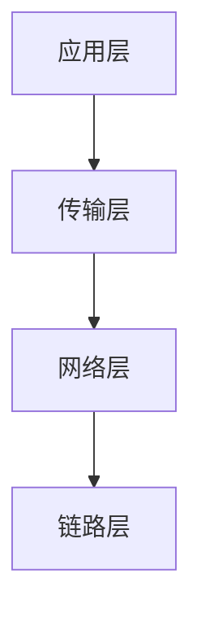
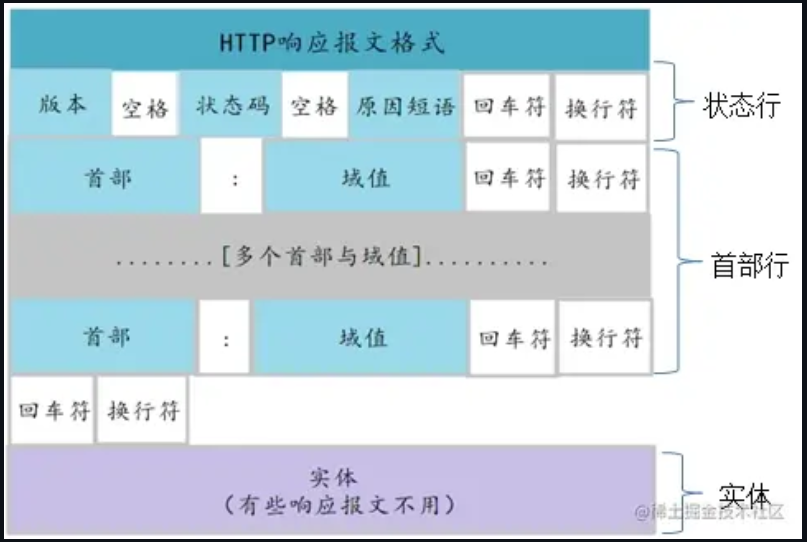
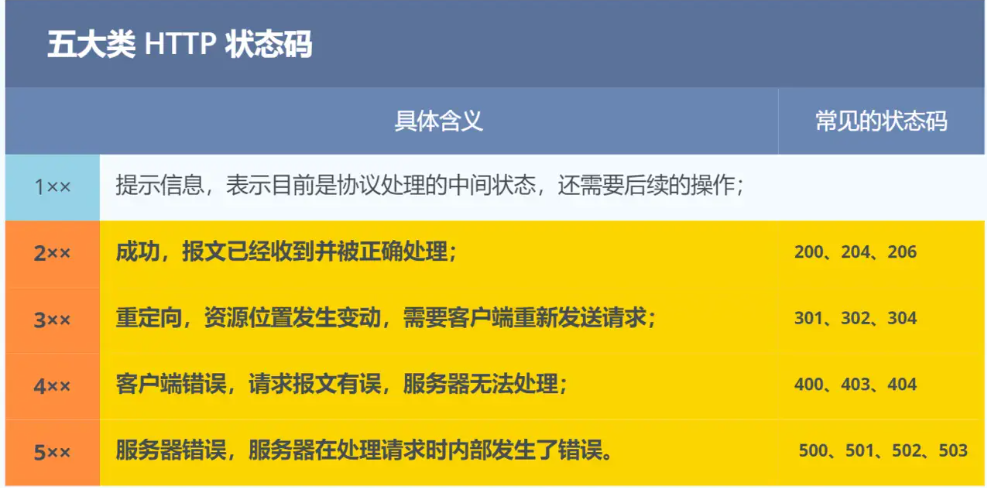
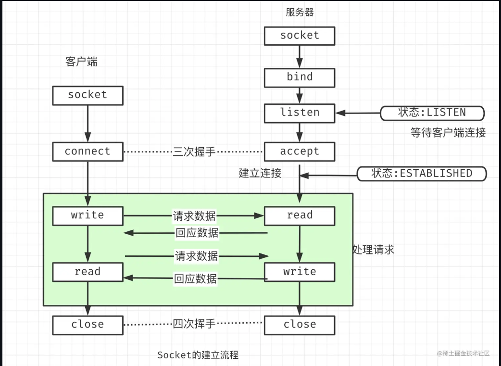
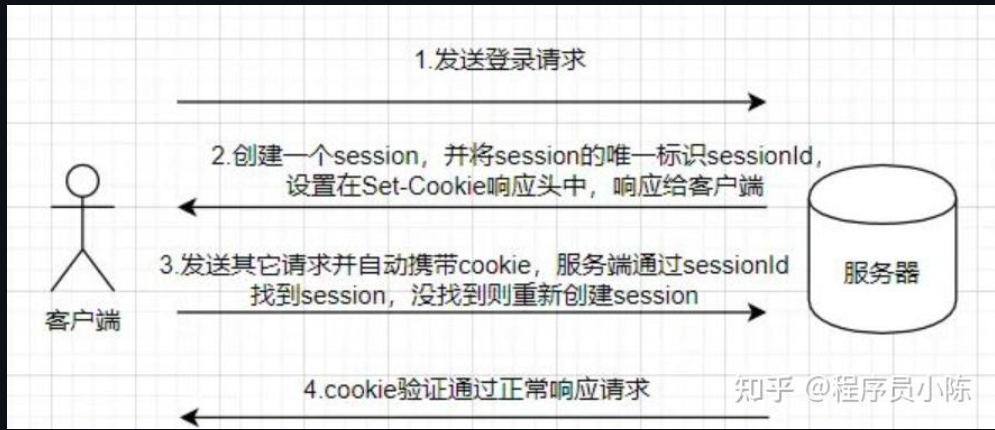
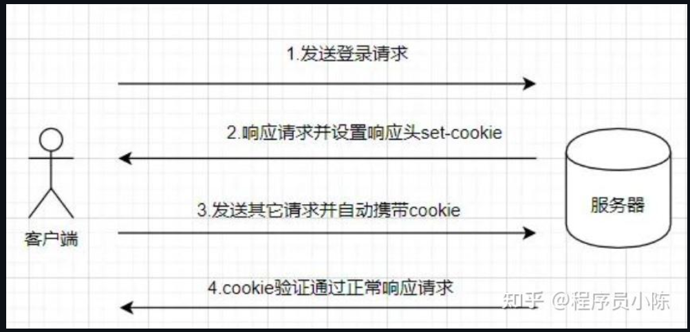
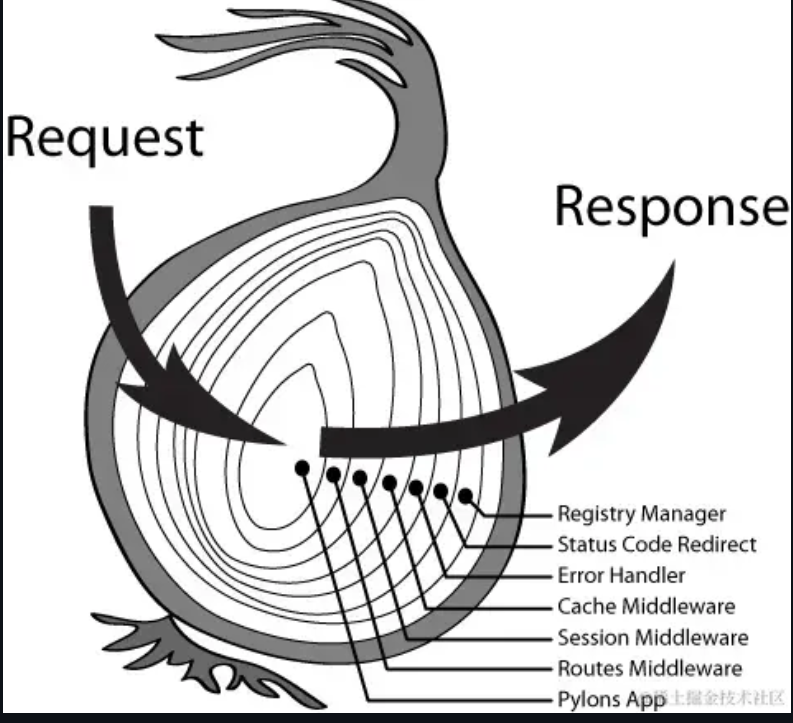
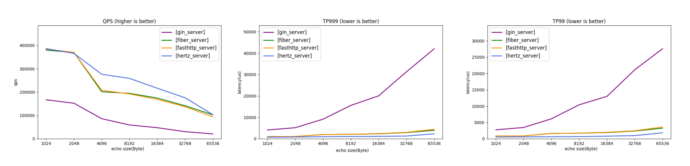
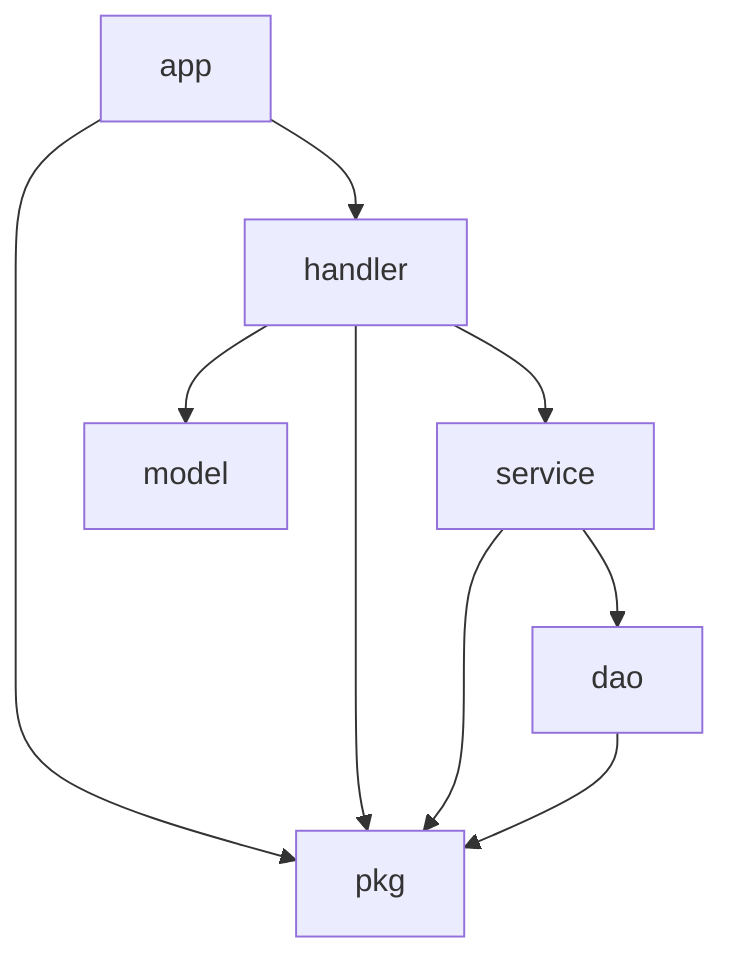
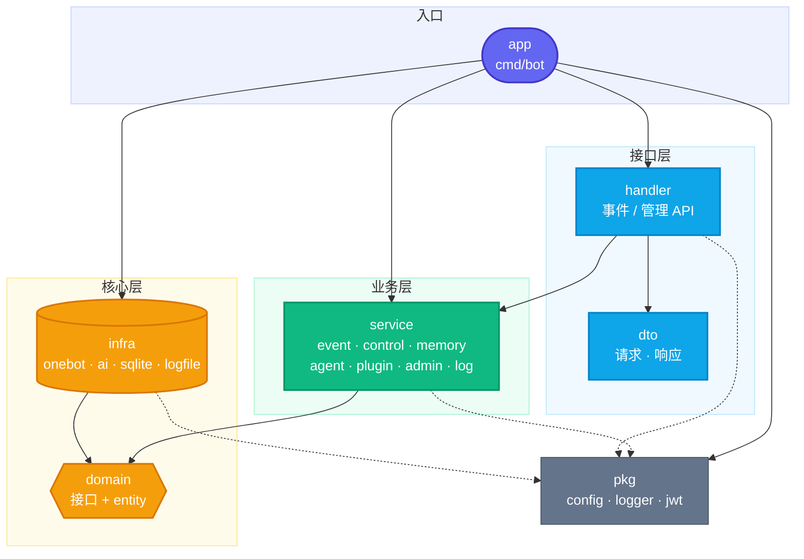

[可以直接看作业](#课后作业)

本片文章很多借鉴上届教程
# Web 开发

## 计算机网络基础

### 文章内容来源

这个偏八股，然后可能有点老，但是对初识我觉得有用：
[小林Coding](https://xiaolincoding.com/network/1_base/tcp_ip_model.html)  
讲的很好的一篇文章：
[上一届的文章](https://github.com/LanshanTeam/Courseware-Backend-Go-2025/blob/main/lesson06/lesson06.md)  
和询问ai，如果有不清楚的询问ai即可，重要的不是背诵，而是理解为什么要这样解决问题，为什么会有http又为什么会有https等。

### 前言
大体看下即可，某些定义具体后面讲解

想象在没有网络前，很远的人如何互相通信，有信封的方式，后来又有电话的方式，再后来还有电报，抽象下可以看作是一个发送者，一个传输者和一个接受者，最后是传输的东西。由于各种问题，产生了不同的解决方法。比如：由于怕传递的信息被中间人偷看或者篡改，有了 TLS 等加密方法；由于在网络中传递的是比特信息，双方需要就如何解析达成一致，所以需要制定好协议，于是有了 HTTP 等应用层协议。而需要将职责分好才能更高效和方便排查问题，所以有网络分层。

网络层次结构（简易）：

|层|职责|
|:--:|:--:|
|应用层|针对应用协议（如SSH，HTTP等），负责按照协议包装数据（比如加一些字段，按照协议格式化等），应用层只需要专注于为用户提供应用功能，比如 HTTP、FTP、Telnet、DNS、SMTP等|
|传输层|除了和外界通信，还有本地软件，而应用在端口中，传输层用来建立端口之间的通信，而传输层也有自己的协议：TCP and UDP，简要区分就是TCP稳UDP快，其实现通常由操作系统实现|
|网络层|为数据包添加IP地址，将源IP地址和目的IP地址写入IP头|
|链路层|添加帧头和MAC地址|

其中MAC地址是用于互联网的硬件之间用于转发的地址（区别于IP）

当然还有表示层，会话层，物理层。
### 应用层

#### **http**

**概念讲解**
---
http是超文本传输协议
- 超文本：意思是为了让人们可以通过网络分享图片，视频等更多不止文字的内容
- 传输：为了成功连接到对方，需要经过中间‘人’的帮助，而在 HTTP 里，需要中间人遵从 HTTP 协议，只要不打扰基本的数据传输，就可以添加任意额外的东西。
- 协议：服务于上面的超文本和传输，制定双方共同遵循的规定，可以理解为为了方便。

所以http可以理解为一个制定好的规范，那他由具体的样子吗，可以看看按照这个协议包装后的具体发送的内容(来自上届图片内容)：

**http请求**


```http
POST /api/login HTTP/1.1
Host: www.example.com
User-Agent: Chrome/110.0
Content-Type: application/json
Content-Length: 45

{"username":"cyjj世界第一可爱","password":"123456"}
```
（注意，这些换行符和回车符就相当于制定的解读协议，你可以想象你自己如果要实现一个协议，那么如何知道哪些地方是什么呢，这里用了换行符和回车符，你自己搞也许可以用各种符号等）

**请求行**：  
方法：

| 方法 | 功能 | 是否幂等 | 特点 |
|:--:|:--|:--:|:--|
| GET | 获取服务器上的资源（数据或页面）。 | 是 | 数据通过 URL 传递<br>不应修改服务器状态<br>适合只读操作<br>会缓存 |
| POST | 向服务器发送数据以创建资源或触发操作。 | 否 | 数据在请求体中<br>用于表单提交、创建资源或触发逻辑 |
| PUT | 更新或创建服务器上的资源（完全替换目标资源）。 | 是 | 数据在请求体中<br>更新时完全覆盖资源<br>常用于资源的创建或更新操作 |
| DELETE | 删除服务器上的指定资源。 | 是 | 删除操作<br>调用多次对结果无影响 |
| PATCH | 更新服务器上的资源（部分更新）。 | 否 | 对资源的部分字段进行修改<br>非幂等（取决于实现方式） |
| HEAD | 类似 GET，但不返回响应体，仅返回响应头。 | 是 | 用于检查资源是否存在或获取元信息 |
| OPTIONS | 返回服务器支持的 HTTP 方法和选项。 | 是 | 用于探测服务器支持的能力<br>不对资源状态产生影响 |
| TRACE | 回显收到的请求，主要用于调试和诊断。 | 是 | 直接返回请求内容<br>不常用，可能存在安全隐患 |
| CONNECT | 用于建立隧道连接，通常用于 HTTPS。 | 否 | 用于代理服务器，主要处理加密的 SSL/TLS 隧道 |

幂等操作的效果在执行一次和多次时是相同的

所谓GET，POST等只是协议，不是强制要求，你要是写自己的应用，将用户应发送数据的请求写GET也行，但是这样不是很符合规范，而且也会由一定问题，比如GET会缓存获取的内容，但是一般本来是POST返回的内容是多变的，所以GET的缓存就没什么用了。

URL：

就是要访问的域名，比如[https://mifibot.space/](https://mifibot.space/)，会在应用层拆分后通过DNS对URL进行解析，like：
https://mifibot.space:443/path?q=1
拆成：  
scheme: https  
host: mifibot.space  
port: 443  
path: /path  
query: q=1  
DNS发现host为mifibot.space  ，于是发起DNS查询，得到IP，比如93.184.216.34。但是添加IP仍然在网络层。应用层把目标 IP、端口、数据交给操作系统 socket由器在内核协议栈处理。（Socket相当于应用层于内核交互的一个接口）

版本：

就是版本

**请求头**

请求头部由关键字/值对组成，每行一对。

|键|值|补充|
|:--:|:--:|:--:|
|Host|请求的目标主机（域名+端口）|HTTP/1.1 中必填，用于一个 IP 上部署多个站点（虚拟主机）|
|User-Agent|产生请求的浏览器类型|比如：Chrome/110.0|
|Accept|客户端可识别的响应内容类型列表|比如：`application/json`、`text/html`、`*/*`|
|Accept-Encoding|客户端支持的压缩方式|比如：`gzip, deflate, br`|
|Accept-Language|客户端偏好的语言|比如：`zh-CN,zh;q=0.9`|
|Content-Type|请求体的数据格式|比如：`application/json`（POST/PUT 才需要）|
|Content-Length|请求体的字节长度|与 Content-Type 配合，告诉服务端读多少数据|
|Authorization|认证凭证|比如：`Bearer <token>`、`Basic <base64>`|
|Cookie|客户端携带的 Cookie|服务端据此识别会话，身份认证的一种|
|Referer|请求是从哪个页面跳转来的|可用于防盗链、来源统计|
|Connection|连接控制|HTTP/1.1 默认 `keep-alive` 复用连接|
|Accept-Charset|可接受的应答的字符集|比如：`utf-8, iso-8859-1;q=0.5`（现代浏览器/服务端基本都用 UTF-8，实际很少设置）|


注意：键名不区分大小写（HTTP 规范要求），习惯上写成上面这种首字母大写的形式。

**空行**

分隔请求头和请求体。如果没有请求体，空行直接结束报文。

**请求体**

就是你要发送的内容，请求体格式由 Content-Type 决定，常见的是 JSON，但也可能是表单、XML、文本、二进制文件、multipart 等。


例如发送一张图片：

```http
POST /upload HTTP/1.1
Host: api.example.com
Content-Type: multipart/form-data; boundary=----WebKitFormBoundaryABC123
Content-Length: 10240

------WebKitFormBoundaryABC123
Content-Disposition: form-data; name="file"; filename="cat.jpg"
Content-Type: image/jpeg

<这里是一大堆二进制图片数据...>
------WebKitFormBoundaryABC123--
```

boundary 参数指定一个分隔字符串（这里是 ----WebKitFormBoundaryABC123），用于分隔请求体中的不同部分。报文最后以 -- 加上 boundary 再加 --（即 ------WebKitFormBoundaryABC123--）明确表示请求体结束.

**http响应**

```http
HTTP/1.1 201 Created
Date: Thu, 05 Nov 2026 10:30:00 GMT
Server: nginx/1.24.0
Content-Type: application/json; charset=utf-8
Content-Length: 186
Location: https://api.example.com/users/123/avatar

{
  "code": 0,
  "message": "上传成功",
  "data": {
    "userId": 123,
    "username": "张三"
  }
}
```


**状态行**

版本：

服务端版本

状态码：

协议中表示服务器状态，具体：



同GET等方法一样是认为约定尽量遵守规则

**响应头**

常见响应头

|键|值|补充|
|:--:|:--:|:--:|
|Date|消息产生的时间|响应生成的 GMT 时间，如 `Thu, 05 Nov 2026 10:30:00 GMT`|
|Age|（从最初创建开始）响应持续时间|单位为秒，主要用于缓存，表示该响应在缓存里存了多久|
|Server|向客户端标明服务器程序名称和版本|如 `nginx/1.24.0`|
|ETag|不透明验证者|资源的版本标识，配合 `If-None-Match` 做缓存校验，命中可返回 304|
|Location|URL 备用的位置|配合 3xx 重定向或 201 Created 使用，告诉客户端新地址|
|Content-Length|实体的长度|响应体的字节数|
|Content-Type|实体的媒体类型|如 `application/json; charset=utf-8`|
|Content-Encoding|实体的压缩方式|如 `gzip, deflate, br`，与请求头的 `Accept-Encoding` 对应|
|Cache-Control|缓存控制策略|如 `max-age=3600`、`no-cache`、`no-store`|
|Expires|缓存的过期时间|HTTP/1.0 的方案，优先级低于 `Cache-Control`|
|Last-Modified|资源最后修改的时间|配合 `If-Modified-Since` 做缓存校验|
|Set-Cookie|服务端下发的 Cookie|如 `sessionId=abc123; Path=/; HttpOnly`|

其余类似请求

**DNS and IP**

主要作用是把人类容易记住的域名（如 www.example.com）翻译成机器使用的 IP 地址（如 93.184.216.34）。可以把它理解成互联网的“电话簿”

DNS 负责把域名翻译成 IP 地址；但 IP 地址要真正用于通信，还需要子网掩码（或 CIDR 前缀）来判断“目标在不在同一个网络里”。

例如看到：93.184.216.34/24

93.184.216.34 是 IPv4 地址，IPv4 一共 32 位。/24 叫 CIDR 前缀长度，表示前 24 位是网络位，后 8 位是主机位。

为什么呢。你看，24标识前24位作为网络位，但是你看这里93.184.216.34 没有24个位，因为这里指十进制，

而93.184.216.34 的二进制：01011101.10111000.11011000.00100010，

而掩码是24即前24位：255.255.255.0

其二进制：11111111.11111111.11111111.00000000

将11111111.11111111.11111111.00000000（掩码）与01011101.10111000.11011000.00100010（93.184.216.34）进行按位与计算得到：

01011101.10111000.11011000.00000000

这样只有前24位有效了。
**HTTP缓存技术**
- 强制缓存

只要浏览器判断缓存没有过期，则直接使用浏览器的本地缓存，决定是否使用缓存的主动性在于浏览器这边。

利用HTTP响应头的两个字段：Cache-Control， 是一个相对时间，Expires，是一个绝对时间，Cache-Control 的优先级高于 Expires 。请求时计算当前时间与设置的过期时间，如果没有过期则使用缓存。
- 协商缓存

请求的响应码是 304，这个是告诉浏览器可以使用本地缓存的资源。

实现方法；

1. 请求头部中的 If-Modified-Since 字段与响应头部中的 Last-Modified 字段实现。
- 响应头部中的 Last-Modified：标示这个响应资源的最后修改时间；
- 请求头部中的 If-Modified-Since：当资源过期了，发现响应头中具有 Last-Modified 声明，则再次发起请求的时候带上 Last-Modified 的时间，服务器收到请求后发现有 If-Modified-Since 则与被请求资源的最后修改时间进行对比（Last-Modified），如果最后修改时间较新（大），说明资源又被改过，则返回最新资源，HTTP 200 OK；如果最后修改时间较旧（小），说明资源无新修改，响应 HTTP 304 走缓存。
1. 请求头部中的 If-None-Match 字段与响应头部中的 ETag 字段。
- 响应头部中 Etag：唯一标识响应资源
- 请求头部中的 If-None-Match：当资源过期时，浏览器发现响应头里有 Etag，则再次向服务器发起请求时，会将请求头 If-None-Match 值设置为 Etag 的值。服务器收到请求后进行比对，如果资源没有变化返回 304，如果资源变化了返回 200。

[以上内容来源](https://xiaolincoding.com/network/2_http/http_interview.html)

---

## Go

### http包
看看go的http包(来自上届)：

下面大体讲解的服务端：
```go
package main

import (
	"fmt"
	"net/http"
)

// PingHandler 是一个独立封装的处理函数
func PingHandler(w http.ResponseWriter, r *http.Request) {
	if r.Method != http.MethodGet {
		http.Error(w, "Method Not Allowed", http.StatusMethodNotAllowed)
		return
	}//判断请求方法是否是GET
	w.Write([]byte("pong"))
}

// HelloHandler 返回 "Hello, World!"
func HelloHandler(w http.ResponseWriter, r *http.Request) {
	w.Write([]byte("Hello, World!"))
}

func main() {
	// 创建自定义的多路复用器
	mux := http.NewServeMux()

	// 注册路由，使用封装的处理函数
	mux.HandleFunc("/ping", PingHandler)
	mux.HandleFunc("/hello", HelloHandler)

	// 创建自定义的 HTTP 服务器
	server := &http.Server{
		Addr:    ":8080", // 监听地址和端口
		Handler: mux,     // 使用自定义的多路复用器
	}

	// 启动服务器
	fmt.Println("Server is running at http://localhost:8080")
	if err := server.ListenAndServe(); err != nil {
		fmt.Println("Error starting server:", err)
	}
}

```
逐个分析：

可以看到`http.Server`中的Handler字段用了mux，而mux由 http.NewServeMux()创建。其类型为：*http.ServeMux。这个是什么呢？
是创建的一个多路复用器，也就是帮助解析请求的，可以将这些handler字面理解为处理器的意思，就相当于一条通往工厂的路，而*http.ServeMux
就是用来根据别人发过来的请求判断应该走那条路。

这个路具体是什么呢？就是mux.HandleFunc("/ping", PingHandler)中的PingHandler，可以查看到mux.HandleFunc()的函数原型：
```go
func (mux *http.ServeMux) HandleFunc(pattern string, handler func(http.ResponseWriter, *http.Request))
```
其中PingHandler对应func(http.ResponseWriter, *http.Request)。而看到PingHandler的入参就是于这个一致。

而http.Request就是go帮你对请求做的解析，方便你操作请求获取请求的内容，比如当前的： r.Method != http.MethodGet就是判断当前请求的请求方法是否是GET，其中 http.MethodGet是
http包的常量：
```go
package http

// Common HTTP methods.
//
// Unless otherwise noted, these are defined in RFC 7231 section 4.3.
const (
	MethodGet     = "GET"
	MethodHead    = "HEAD"
	MethodPost    = "POST"
	MethodPut     = "PUT"
	MethodPatch   = "PATCH" // RFC 5789
	MethodDelete  = "DELETE"
	MethodConnect = "CONNECT"
	MethodOptions = "OPTIONS"
	MethodTrace   = "TRACE"
)
```
而http.ResponseWriter是方便在连接中写回复内容的，无需自行处理格式，由包帮你完成，比如当前的w.Write([]byte("pong"))就是写一个回复pong,这就是常见的ping pong,你可以在蓝山qq群对蓝莓发送"/ping"，如果服务器正常则蓝莓会恢复pong。
具体可以自行查看源码，在当前目录test中右键函数或者类型进行跳转。

简单讲解下回复：

1. 发送文字：
```go
func Texthandler(w http.ResponseWriter, r *http.Request) {
    w.Header().Set("Content-Type", "text/plain; charset=utf-8")//设置响应头
    w.WriteHeader(http.StatusOK)          // 写入状态码
    fmt.Fprint(w, "你好,世界\n") //向w中写入，可以自行看看fmt.Fprint
    // 或 w.Write([]byte("你好,世界\n"))
}
```
2. 发送文件
```go
func DownloadHandler(w http.ResponseWriter, r *http.Request) {
    w.Header().Set("Content-Disposition", `attachment; filename="report.pdf"`)
    http.ServeFile(w, r, "/var/data/report.pdf")//通过辅助函数 http.ServeFile写入
    /*
    ServeFile 自动帮你处理:Content-Type(按扩展名)Content-Length
    Last-Modified / ETag / 条件请求(304)
    Range 请求(断点续传、视频拖动进度条)
    HEAD 请求
    目录请求
    Content-Disposition 决定浏览器是"下载"(attachment)还是"内联展示"(inline,图片/PDF 可直接显示)
    */
    //也还有其他方法和细节，询问ai即可
    
}
```
你可能看到，其实这个 http.ServeFile的内部没有用boundary，就是前面讲到的传输文件的分界线，因为需要分界线的是multipart报文格式，而ServeFile传输用的是字节流
```http
HTTP/1.1 200 OK
Content-Type: application/pdf
Content-Length: 1048576
Last-Modified: Fri, 06 Nov 2026 08:00:00 GMT
Accept-Ranges: bytes
Content-Disposition: attachment; filename="report.pdf"

<PDF 文件的原始二进制, 1048576 字节, 没有任何 boundary>
```

如果想要用form-data格式，需要用到"mime/multipart"
具体如何在客户端，服务端发送不同内容，简易自行学习（很多）。

现在讲解下大体过程；



我不是很想讲解源码，不过为了继承前辈的文章，还是选择写。这些都是了解即可，不用担心一时看不懂，而且源码这些都在变，比如ListenAndServe()的实现都跟上届文章提及的变化了。

注：Socket是一个软件层面的抽象概念操作系统和应用程序之间的桥梁。对于程序来说，网络通信就变成了简单的“打开 Socket（打电话） -> 往 Socket 读写数据（说话） -> 关闭 Socket（挂电话）”的流程。在 Go 中，Socket 是被 net 包深度封装后的 net.Conn 接口，net/http 包是对 net.Conn 的二次包装。

先看到http.Server的结构体：
```go
type Server struct {
	Addr string
	Handler Handler
	DisableGeneralOptionsHandler bool
	TLSConfig *tls.Config
	ReadTimeout time.Duration
	ReadHeaderTimeout time.Duration
	WriteTimeout time.Duration
	IdleTimeout time.Duration
	MaxHeaderBytes int
	MaxHeaderValueCount int
	TLSNextProto map[string]func(*Server, *tls.Conn, Handler)
	ConnState func(net.Conn, ConnState)
	ErrorLog *log.Logger
	BaseContext func(net.Listener) context.Context
	ConnContext func(ctx context.Context, c net.Conn) context.Context
	HTTP2 *HTTP2Config
	Protocols *Protocols
	DisableClientPriority bool
	inShutdown atomic.Bool
	disableKeepAlives atomic.Bool
	nextProtoOnce     sync.Once
	nextProtoErr      error
	mu            sync.Mutex
	listeners     map[*net.Listener]struct{}
	activeConn    map[*conn]struct{}
	onShutdown    []func()
	h2            *http2Server
	h2Config      http2ExternalServerConfig
	h2IdleTimeout time.Duration
	h3            *http3ServerHandler
	listenerGroup sync.WaitGroup
}
```
肯定不会一个字段一个的来讲。（大概作用其实通过英文字面意思可以猜到）

看到常用的关键字段：Addr，Handler...，一个就是服务的监听的端口地址，一个就是前面说的多路复用器了
```go
type Handler interface {
	ServeHTTP(ResponseWriter, *Request)
}//前面通过http.NewServeMux()就是返回了一个实现了Handler接口的一个结构体ServeMux
// 其ServeMux的 ServeHTTP实现如下，存储你通过mux.HandleFunc设置的函数用的决策树与自适应 mapping（具体我也没看）
func (mux *ServeMux) ServeHTTP(w ResponseWriter, r *Request) {
	if r.RequestURI == "*" {
		if r.ProtoAtLeast(1, 1) {
			w.Header().Set("Connection", "close")
		}
		w.WriteHeader(StatusBadRequest)
		return
	}
	var h Handler
	if use121 {
		h, _ = mux.mux121.findHandler(r)
	} else {
		h, r.Pattern, r.pat, r.matches = mux.findHandler(r)//这里就是在内部查询你mux.HandleFunc保存的路由函数
	}
	h.ServeHTTP(w, r)
}
```

server字段知道了，可以看到server如何创建socket（Socket 可以看作是一个端点，它连接两个设备（通常是客户端和服务器）之间的通信通道，支持在它们之间传输数据）的：
```go
func (s *Server) ListenAndServe() error {
	if s.shuttingDown() {
		return ErrServerClosed
	}
	addr := s.Addr
	if addr == "" {
		addr = ":http"
	}
	ln, err := net.Listen("tcp", addr)// <-----看这里，listen它会创建一个底层的套接字（Socket），并绑定到指定的地址和端口
	if err != nil {
		return err
	}
	return s.Serve(ln)//这里就到了图片中的等待客户端连接，前面的bind就是讲刚刚创建的 Socket（套接字）与特定的 IP 地址和端口号（Port）绑定在一起。
}
```
我们知道的是http/1.0版本中是一次连接一问一答的模式，http/1.1默认了长连接。

那么在go中其实是通过for循环实现的一个连接处理多次请求：

看到上面最后的s.Serve(ln):

```go
func (s *Server) Serve(l net.Listener) error {
	//...省略一堆代码
	for {
		rw, err := l.Accept()// 这里接受连接，阻塞等待一个新的连接（从内核队列里取出一个已经建立好的 TCP 连接）
		if err != nil {
			if s.shuttingDown() {
				return ErrServerClosed
			}
			if ne, ok := err.(net.Error); ok && ne.Temporary() {
				if tempDelay == 0 {
					tempDelay = 5 * time.Millisecond
				} else {
					tempDelay *= 2
				}
				if max := 1 * time.Second; tempDelay > max {
					tempDelay = max
				}
				s.logf("http: Accept error: %v; retrying in %v", err, tempDelay)
				time.Sleep(tempDelay)
				continue
			}
			return err
		}
		connCtx := ctx
		if cc := s.ConnContext; cc != nil {
			connCtx = cc(connCtx, rw)
			if connCtx == nil {
				panic("ConnContext returned nil")
			}
		}
		tempDelay = 0
		c := s.newConn(rw)
		c.setState(c.rwc, StateNew, runHooks) // before Serve can return
		go c.serve(connCtx)//通过协程并发处理请求，对了，你经常会看到ctx这几个字，叫上下文，就是一个很强大的结构体。可以理解为装了各种信息和工具的工具箱。
	}
}
```
后续就不继续写了，后面c.serve(connCtx)中看到serverHandler{c.server}.ServeHTTP(w, w.req)，这里调用函数ServeHTTP通过里面handler.ServeHTTP(rw, req)又里面的h, _ := mux.Handler(r)获取到当前请求对应的处理函数。

z这里讲一下前面的Handler的点，你可以看到http.NewServeMux()返回的结构体http.ServeMux（这个其实和你自己写的handler函数一样，只是职责是帮助路由，相当于一个专门用来路由到其他工厂的工厂）可以通过其实还有mux.Handle,一个输入函数每一个输入结构体（当然这个结构体要实现ServeHTTP(w http.ResponseWriter, r *http.Request)），那么你是否意识到一个巧妙的点，怎么有时结构体又是函数的，难道http.Server结构体内部分别存储了两个吗？实则不是的，是通过：
```go
// 1. 定义底层类型为函数
type HandlerFunc func(ResponseWriter, *Request)

// 2. 给这个函数类型绑个方法，让它满足 Handler 接口
func (f HandlerFunc) ServeHTTP(w ResponseWriter, r *Request) {
    f(w, r) 
}
```
这样用mux.HandleFunc注册其实是相当于将传入的函数转换成了HandlerFunc 类型，而HandlerFunc实现了ServeHTTP，于是也变成了 Handler 接口。

而此时我们也就明白了多路复用器更深的一层。你看到http.Server结构体只有一个Handler，多路复用器就是用自己一个将其他多个自己写的“工厂”路由，其本身没有业务，你会想，那么
为什么注册的工厂（函数或者结构体）需要实现Handler接口呢，我们看到多路复用器底层存储路由表：
```go
type ServeMux struct {
	mu     sync.RWMutex
	tree   routingNode
	index  routingIndex
	mux121 serveMux121 
}
type routingNode struct {
	pattern *pattern
	handler Handler

	children   mapping[string, *routingNode]
	multiChild *routingNode 
	emptyChild *routingNode 
}
```
饿啊，终于知道为什么了，SercerMux内部通过树来维护注册的Handler，其中树的节点在就可以看到存储的是Handler类型了，于是这样go中既可以直接写简单函数注册，也可以写复杂的结构体来注册了

没事，慢慢理解就行，多自己看源码，我这里讲的不是很连贯，你可能有点混淆。（你还需要知道的就是这里讲的http包是对net包的二次包装，可以自行了解net包如何使用，后面也有net包的链接）
接下来是客户端：

如何发送http请求；

简单的调用：
```go
resp, err := http.Get("http://example.com")
```
不简单的调用
```go
// 创建一个新的 POST 请求
req, err := http.NewRequest("POST", "http://example.com", bytes.NewBuffer([]byte(`{"key":"value"}`)))
if err != nil {
  log.Fatal(err)
}
// 设置自定义请求头
req.Header.Set("Content-Type", "application/json")
// 创建一个客户端并发起请求
client := &http.Client{}
resp, err := client.Do(req)
if err != nil {
  log.Fatal(err)
}
defer resp.Body.Close()
```
使用命令行：
- GET：
  ```bash
  curl http://example.com
  ```
- POST
  ```bash
  curl -X POST http://example.com -d "name=John&age=30"
  # 也可以发送 JSON 数据：
  curl -X POST http://example.com -H "Content-Type: application/json" -d '{"name": "John", "age": 30}'
  # 使用 -H 参数来添加自定义请求头：
  curl -X GET http://example.com -H "Authorization: Bearer YOUR_TOKEN"
  ```
更多问ai

### 身份验证

你想想，如果你在写一个用户账号系统，用户需要登录，现在他发送一个请求，你查询数据库，发现存在，于是返回ok。
然后用户想进行一些必须登录后才可以进行的操作，比如支付，现在他发送支付5元，你有发现上面问题吗？
```
请求A：
{
  "账号":"cyjj",
  "密码":"kqjj"
}
回复：
{
  "msg":"ok"
}
请求B：
{
  "收款人":"grtjj",
  "支付":"50元"
}
```
很显然，你不知道B是否是原来登录的A发送过来的，而且你也不希望每次请求都要写账号密码，于是有了一种方法来判断是否是位于一个会话（身份证明）

有三种：
- Cookie：存储在客户端，由服务器发送给客户端的小型文本文件，户端发送请求时，浏览器会自动将相应的 Cookie 信息发送给服务器，服务器通过读取 Cookie 信息，就可以判断该请求来自哪个客户端。但是数据可以被轻易查看（因为是浏览器保存的，会持久化，自动发送，）。

- Session:由服务端创建，当一个请求发送到服务端时，服务器会检索该请求里面有没有包含 sessionId 标识，如果包含了 sessionId，则代表服务端已经和客户端创建过 session，然后就通过这个 sessionId 去查找真正的 session，如果没找到，则为客户端创建一个新的 session，并生成一个新的 sessionId 与 session 对应，然后在响应的时候将 sessionId 给客户端，通常是存储在 cookie 中。如果在请求中找到了真正的 session，验证通过，正常处理该请求。

每一个客户端与服务端连接，服务端都会为该客户端创建一个 session，并将 session 的唯一标识 sessionId 通过设置 Set-Cookie 头的方式响应给客户端，客户端将 sessionId 存到 cookie 中。(通过设置请求头设置Cookie，go中有http.SetCookie，gin框架也有自己的api，具体询问ai即可)
```http
Set-Cookie: <cookie-name>=<cookie-value>; <attribute1>=<value1>; <attribute2>=<value2>; ...
# 比如
Set-Cookie: session_id=abc123xyz; Path=/; Domain=example.com; Max-Age=3600; Secure; HttpOnly; SameSite=Lax
```
- Token：Token 是一种在客户端和服务端之间传递身份信息的方式。当用户登录成功后，服务端会生成一个 Token，将其发送给客户端。客户端在后续的请求中，需要将 Token 携带在请求头或请求参数中。服务端通过验证 Token 的合法性，就可以确定该请求来自哪个用户，并且可以根据用户的权限进行相应的操作。Token 可以有效地避免了 Cookie 的一些安全问题，比如 CSRF 攻击。
Token是一个由一串字符组成的令牌，通常由三个部分组成：标头、有效载荷、签名：
  - 标头（Header）：包含了算法和类型，用于指定如何对有效载荷进行编码和签名。常用的算法有HMAC、RSA、SHA等。
  - 有效载荷（Payload）：包含了一些信息，如用户ID、角色、权限等，用于验证身份和授权。有效载荷可以是加密的，也可以是明文的。
  - 签名（Signature）：是对标头和有效载荷进行签名后得到的值，用于验证token的完整性和真实性。签名通常使用私钥进行签名，并使用公钥进行验证。（可以先了解非对称式加密，简要就是，A，B密钥和C内容，A加密C，仅B可解密C，A可以继续加密C，反过来一样）

Access Token:

Refresh Token: 专用于刷新 access token 的 token。

- JWT: JSON Web Token（简称 JWT）是目前最流行的跨域认证解决方案。是一种认证授权机制，是token的一种实现形式。
使用 HMAC 算法或者是 RSA 的公/私秘钥对 JWT 进行签名。因为数字签名的存在，这些传递的信息是可信的。(这里需要了解完HTTPS就明白私钥和公钥了)


以下内容来自上届：

用户登陆时
- 服务器：

  1. 验证用户凭据（如查询数据库验证用户名和密码是否匹配）。
  2. 如果验证成功，生成一个 JWT：
    - **Header（头部）：**定义算法和类型。
    - **Payload（载荷）：**包含用户信息和一些声明（如用户ID、角色、Token过期时间等）。
    - **Signature（签名）：**使用指定的签名算法（如 HMAC SHA256）和密钥，生成 Token 的签名。
- JWT 生成示例：
```json
Header:
{
  "alg": "HS256",
  "typ": "JWT"
}

Payload:
{
  "user_id": 114514,
  "role": "admin",
  "exp": 1716579600
}
```
- 生成的 JWT：
```
eyJhbGciOiJIUzI1NiIsInR5cCI6IkpXVCJ9
.
eyJ1c2VyX2lkIjoxMjMsInJvbGUiOiJhZG1pbiIsImV4cCI6MTcxNjU3OTYwMH0
.
abc123signature
```
- 响应示例：
```
HTTP/1.1 200 OK
Content-Type: application/json

{
  "token":"eyJhbGciOiJIUzI1NiIsInR5cCI6IkpXVCJ9.eyJ1c2VyX2lkIjoxMjMsImV4cCI6MTY3OTg4ODAwMH0.signature"
}
```
- 客户端：

  - 接收到服务器返回的 JWT，将其存储在客户端（通常是 localStorage 或 sessionStorage也可以是cookie）。
  - 后续请求中，客户端会将 JWT 作为凭证发送给服务器。
用户访问被保护的资源时
- 客户端：

  - 在请求受保护资源时，客户端通过 HTTP 请求头将 JWT 发送到服务器。

  - 请求头中通常使用 Authorization: Bearer <token> 格式。

- 服务端：

  1. 检查请求头中的 Authorization 是否包含 JWT。
  2. 提取 JWT 并验证：
    - **签名验证：**使用密钥验证签名是否正确，确保 Token 未被篡改。
    - **过期时间验证：**检查 exp 字段是否未过期。
    - **其他验证：**检查 iss（发行者）和 aud（受众）是否匹配。
  验证成功后，解析 Payload，提取用户信息和权限。

  如果 Token 无效或过期，返回 401 Unauthorized 错误

因为 JWT 是自包含的（内部包含了一些会话信息），因此减少了需要查询数据库的需要

因为用户的状态不再存储在服务端的内存中，所以这是一种无状态的认证机制生成

如何使用JWT
在go语言中使用JWT一般使用https://github.com/golang-jwt/jwt这个库

或者https://github.com/dgrijalva/jwt-go这个库，不过第二个库已经不再维护了

在gin中是使用一个中间件去验证jwt的（注意一般登陆，注册接口不需要验证jwt）

当然可能有些web框架提供了自己的jwt实现

现在网上的在gin中使用jwt的文章可以参考，不过注意甄别版本

因为很多文章用的第一个库的v4版本，不过现在那个库已经更新到v5版本了

jwt库的文档：https://golang-jwt.github.io/jwt/

jwt库的api文档：https://pkg.go.dev/github.com/golang-jwt/jwt/v5

### cors跨域

也就是服务的运行哪些地方来点请求可以进来，[前辈的文章](https://blog.csdn.net/Stromboli/article/details/143749708)
### 学习参考链接：  
[HTTP是什么（视频）](https://www.bilibili.com/video/BV1zb4y127JU/?share_source=copy_web&vd_source=fede6b7cbc276e206b4820d9bc3249aa)  
[TCP三次握手和四次挥手（视频）](https://www.bilibili.com/video/BV18h41187Ep/?share_source=copy_web&vd_source=fede6b7cbc276e206b4820d9bc3249aa) 
[http是什么（文章）](https://xiaolincoding.com/network/2_http/http_interview.html) 
[tcp模型（文章）](https://xiaolincoding.com/network/1_base/tcp_ip_model.html)  
[HTTP/1.1，HTTP/2和HTTP/3的区别（视频）](https://www.bilibili.com/video/BV1vv4y1U77y/?share_source=copy_web&vd_source=fede6b7cbc276e206b4820d9bc3249aa)  
[Cookie、Session、Token究竟区别在哪？如何进行身份认证，保持用户登录状态？(视频)](https://www.bilibili.com/video/BV1ob4y1Y7Ep/?share_source=copy_web&vd_source=fede6b7cbc276e206b4820d9bc3249aa)  
[Ciallo～(∠・ω< )⌒⭐](https://mife-user.github.io/posts/go%E8%AF%AD%E8%A8%80%E5%BA%93%E5%8C%85%E5%AD%A6%E4%B9%A0/)
## 框架

框架是什么呢，就是个强大的工具包。
### gin

[gin的文档h](ttps://gin-gonic.com/zh-cn/docs/introduction/)

[gin的api文档](https://pkg.go.dev/github.com/gin-gonic/gin#section-readme)

gin很好用的对于新人也很好上手，一般我自己其实也用不上多少api，我记得很多就gin.Default,然后加组，设置中间件，解析请求等

而且现在ai很强大，背诵api没有意义（至于为什么上面写了很多详细的api和内部结构，是为了借此加深你对go本身及http协议处理的理解，不过学习需要兴趣，也无需在意是否有用，你感兴趣就学，我一方面就是懒的写了💩），所以相比于上面的知识性内容我不打算细说框架的api，怎么用，就说说框架的特点，简单的示例和一些机制。

你自己学习的话，一是看官方文档，二是看示例，三是让ai写示例，四是自己上手写demo。如果你有时间并对框架底层感兴趣也可以自己看
源码和借助ai辅助。

核心特点：

- 零分配路由与基数树： gin的高性能是基于基数树（Radix Tree）实现路由，路由过程中不使用反射实现了零堆内存分配。
- 中间件机制：Gin拥有一个可扩展的中间件系统。HTTP请求可以被一系列中间件（如日志、认证、GZIP压缩）和最终的处理函数依次处理，这种设计极大地提升了框架的可扩展性，中间件可以看作是请求到你写业务逻辑中间的处理逻辑，比如你要写一个账户注册，中间件可以在请求到你业务代码前完成日志日记记录，拦截限流等，主要是为了方便，你也不想一个业务一个自己写的日志，限流等。
- 内置崩溃恢复：Gin自带恢复中间件，能够捕获HTTP请求处理过程中发生的panic并从中恢复，防止单个请求的异常导致整个服务器崩溃，确保了服务的高可用性。
- 极简的API设计：我觉得上手很快🤗

示例：
```go
package main

import (
  "net/http"

  "github.com/gin-gonic/gin"
)

func main() {
  r := gin.Default()//创建默认服务
  r.GET("/ping", func(c *gin.Context) {//注册GET请求类型的路由
    c.JSON(http.StatusOK, gin.H{
      "message": "pong",
    })//在响应体写入json格式内容和状态码200（http.StatusOK）
  })
  r.Run() // listen and serve on 0.0.0.0:8080
}
```
机制：

中间件：



比如通过r.Use(Logger())设置logger中间件（Logger是个函数），我们将器看作B，将请求看作A，将你写的业务
看作C，那么流程是A->B->C->B->A,这就是[洋葱学姐](https://github.com/Lqingzhe)。
### hertz（字节开源的框架）

因为我没用过，所以直接借助前辈的力量了。

Hertz是一个 Go 微服务 HTTP 框架，在设计之初参考了其他开源框架 fasthttp、gin、echo 的优势， 并结合字节跳动内部的需求，使其具有高易用性、高性能、高扩展性等特点，目前在字节跳动内部已广泛使用。 如今越来越多的微服务选择使用 Go，如果对微服务性能有要求，又希望框架能够充分满足内部的可定制化需求，Hertz 会是一个不错的选择

他的优点有：

1. 高易用性
2. 高性能 Hertz 默认使用自研的高性能网络库 Netpoll，在一些特殊场景相较于 go net，Hertz 在 QPS、时延上均具有一定优势 1763956515032

3. 高扩展性
4. 多协议支持
5. 网络层切换能力 Hertz 实现了 Netpoll 和 Go 原生网络库 间按需切换能力，用户可以针对不同的场景选择合适的网络库，同时也支持以插件的方式为 Hertz 扩展网络库实现。
示例

## 项目架构

就是将软件看作现实建筑一样的工程，需要有分工，有体系架构（什么“人”该做什么事）

这个需要自己体悟，同时我觉得也是ai时代一个挺珍贵的技能，我讲一下自己的体悟（请不要以我为准，可以多看看开源的大项目等，有个小方法，可以看看Java中Spring Boot生成的代码架构学习借鉴）：

简单单体架构：

不要在意每层的名字，需要理解职责，简单单体架构是，handler依赖service进行请求路由，app依赖handler进行程序启动和组装，service写业务逻辑依赖dao包，dao包用来实现基础服务，比如数据库等，model包用来解析请求数据，pkg是公共层，用来封装一些公共的工具。注意这里是一种逻辑层，并非指的就是go中的包。
我常用的架构（让ai优化了样式图）：

这里多了domain层，entity层，dto层，infra层（原本dao层），domain层是定义的接口，只要infra中实现了这些接口那么可以替换，这样比如将数据库从sqlite替换从Mysql等等，dto层用来解析请求和包装响应。app层组装。

后面还有微服务架构，大概是第十节课。

最后，需要你自己总结学习，架构这个需要经验，我也只是浅说。

## 学习链接推荐

# 课后作业

Lv1
看完文章即可，自行理解即可。
Lv2
写个服务端，业务需要：
1. 注册
2. 登录
3. 发帖子
4. 查询帖子
5. 看帖子
6. 删除帖子
7. 更改帖子
8. 评论帖子
9. 等等发挥想象即可

作业完成形式：写代码完成或写文章讲述如何完成(选择一种即可)

注：文章可以讲解如何用go的各种包的api完成，必要的是需要讲解你会遇到的问题，你如何解决这个问题。
你可以想象一个傻子在用这个系统，他会干出任何事情（不限于乱输入请求，疯狂发送请求）。

作业提交至：[15723556393@163.com](mailto:15723556393@163.com)

最后，编写不易，多少会有错误。😢